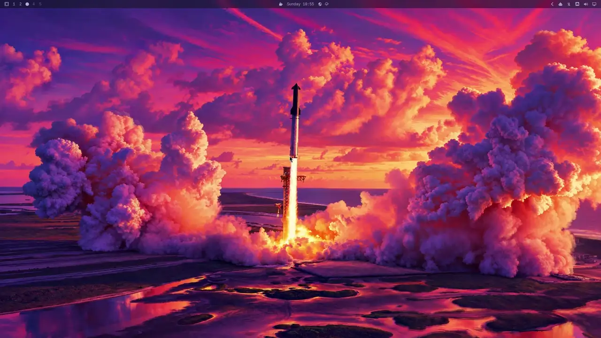
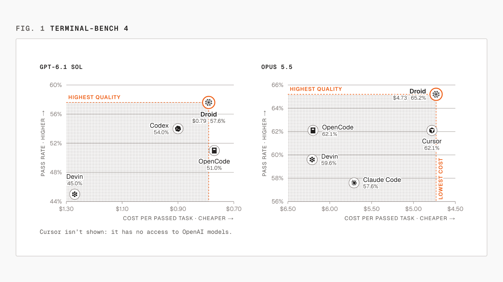

# Factory Desktop Omarchy

Unofficial, experimental Factory Desktop port for Arch Linux and Omarchy on x86_64.



## Features

- Separate Desktop profile. Your standalone Droid CLI stays unchanged.
- Optional Omarchy theme colors and transparency.
- Remote Control, enabled only when you choose.

## Droid 1.0

This port tracks Factory Desktop 1.0.0. Factory presents that generation as
faster, higher scoring and cheaper per completed task than the agents around
it, and publishes the benchmark behind the claim as the figure below.



On the GPT-6.1 Sol panel Droid passes 57.6% of tasks at $0.79 each; Codex
reaches 54.0%, OpenCode 51.0% and Devin 45.0%. On the Opus 5.5 panel it
passes 65.2% at $4.73; OpenCode and Cursor both reach 62.1%, Devin 59.6% and
Claude Code 57.6%. In both panels Droid sits at the top of the pass-rate axis
and at the cheapest end of the cost axis. Cursor is absent from the
GPT-6.1 Sol panel because it has no access to OpenAI models.

The figure is Factory's, measured on Terminal-Bench 4. This port ships the
application unchanged and makes no benchmark claim of its own.

## Install

Requires an Arch-based x86_64 system with user namespaces enabled. Build as your regular user, not root.

```bash
sudo pacman -S --needed git base-devel nodejs npm libsecret python librsvg desktop-file-utils
git clone https://github.com/ash-eriga/factory-desktop-omarchy.git
cd factory-desktop-omarchy
npm run package:sources
SRCDEST="$PWD/build" makepkg -si
```

The build downloads the official app and applies the Linux port locally. No vendor binaries are committed. An AUR package is not available yet.

## Use

Open **Factory Droid Desktop** from your app launcher or run `factory-droid-desktop`.

- Sign in through your browser and allow it to return to the app.
- For theme integration, enable **Settings → Appearance → Follow Omarchy theme**.
- For remote access, enable **Remote Control** in Settings.

## Update

Quit the app and [back up your profile](docs/update.md) first. Then run in your existing clone:

```bash
git pull --ff-only
npm run package:sources
SRCDEST="$PWD/build" makepkg -Csi
```

The app can notify you about stable releases of this port. It never installs updates automatically and does not announce pre-releases. Check manually from **File → Check for port updates…**.

## Uninstall

If you ran `factory-callback register`, restore the previous browser handler first:

```bash
factory-callback rollback
```

Quit the app, then remove the package:

```bash
sudo pacman -R factory-droid-desktop
```

Your Desktop data and standalone Droid CLI are preserved.

## Documentation

[Update and rollback](docs/update.md) · [Architecture](docs/architecture.md) · [Validation](docs/validation.md) · [History](docs/history.md) · [Contributing](CONTRIBUTING.md)

## Contributors

[Factory Droid](https://github.com/apps/factory-droid) contributed to implementation, testing, and review, credited as `factory-droid[bot]` in commits.

## License

The port's code is [MIT](LICENSE). Factory Desktop, Droid, and Factory marks retain their own rights. This port is not supported or endorsed by Factory. See [NOTICE](packaging/NOTICE).
