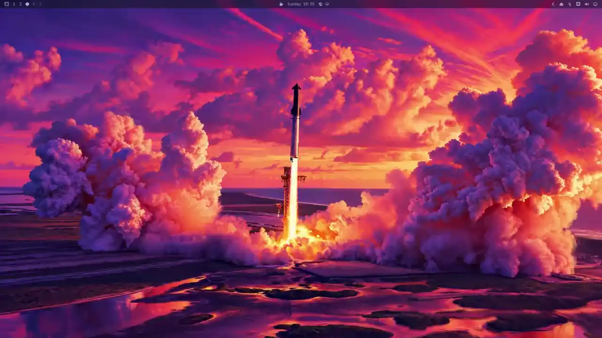
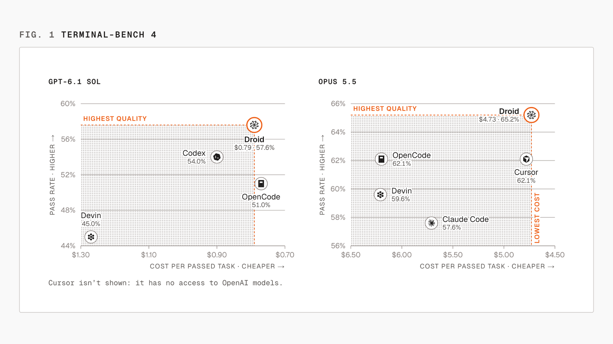

# Factory Desktop Omarchy

Unofficial, experimental Factory Desktop port for Arch Linux and Omarchy on x86_64.

[](media/demo-fast.mp4)

## Features

- Separate Desktop profile. Your standalone Droid CLI stays unchanged.
- Optional Omarchy theme colors and transparency.
- Workstreams active by default, no server-side experiment gate required.
- Remote Control, enabled only when you choose.

## Droid 1.9

This port tracks Factory Desktop 1.9.0, two upstream releases after the
previous ported pin. 1.8.0 puts API keys and service accounts on one Identity
settings page, gives the model-defaults popover the composer's autonomy
levels, caps animated image generation at 16 frames, stops Exec from taking
over a session another machine holds, reveals a new API key immediately,
removes the gray box behind the Git actions button while Droid works, names
the connector rate limit you hit, and makes the Script tool run on Windows.
1.9.0 adds Open in Browser for links in the desktop app, keeps Task
concurrency from starving new sessions, gives every public API operation a
stable identifier and consistent errors, validates hook entries one by one,
keeps the transcript in place when the composer resizes, lets Tasks run
beside other calls in a Script run, reports the run's autonomy level and
working directory from the first hook event, and hardens approvals and
rewind, pending tool calls, file writes, sandboxed Script on Linux, stopping
a stalled session, checkout cleanup and organization owner safeguards. The
upstream changelog lives at
[docs.factory.com/changelog/release-notes](https://docs.factory.com/changelog/release-notes#v1.9.0).
Factory presents the 1.x generation as faster, higher scoring and cheaper per
completed task than the agents around it, and publishes the benchmark behind
the claim as the figure below.

On top of the pinned release, this port fixes three visual defects against
1.9.0's own bytes. On a glassy (Follow Omarchy) window the composer no longer
paints a dark gradient band with a hard edge above it, the Orchestrator chip
renders transparent like every other chip in its row, and the model chip's
text aligns with its neighbours' line instead of sitting a fraction of a
pixel low. An opaque window keeps upstream's rendering untouched.



On the GPT-6.1 Sol panel Droid passes 57.6% of tasks at $0.79 each; Codex
reaches 54.0%, OpenCode 51.0% and Devin 45.0%. On the Opus 5.5 panel it
passes 65.2% at $4.73; OpenCode and Cursor both reach 62.1%, Devin 59.6% and
Claude Code 57.6%. In both panels Droid sits at the top of the pass-rate axis
and at the cheapest end of the cost axis. Cursor is absent from the
GPT-6.1 Sol panel because it has no access to OpenAI models.

The figure is Factory's, measured on Terminal-Bench 4. This port ships the
application unchanged and makes no benchmark claim of its own.

## Install

Requires an Arch-based x86_64 system with user namespaces enabled. Build as your regular user, not root.

```bash
sudo pacman -S --needed git base-devel nodejs npm libsecret python librsvg desktop-file-utils
git clone https://github.com/ash-eriga/factory-desktop-omarchy.git
cd factory-desktop-omarchy
npm run package:sources
SRCDEST="$PWD/build" makepkg -si
```

The build downloads the official app and applies the Linux port locally. No vendor binaries are committed.

The package is not in the AUR yet. The [AUR publishing guide](docs/aur.md) covers how the maintainer prepares the release, exports the submission and pushes it by hand. After that first push, `yay -S factory-droid-desktop` installs it and `yay -Syu` updates it. `pacman -Syu` does not update AUR packages.

## Use

Open **Factory Droid Desktop** from your app launcher or run `factory-droid-desktop`.

- Sign in through your browser and allow it to return to the app.
- For theme integration, enable **Settings → Appearance → Follow Omarchy theme**.
- For remote access, enable **Remote Control** in Settings.

## Update

Quit the app and [back up your profile](docs/update.md) first. Then run in your existing clone:

```bash
git pull --ff-only
npm run package:sources
SRCDEST="$PWD/build" makepkg -Csi
```

The app can notify you about stable releases of this port. It never installs updates automatically and does not announce pre-releases. Check manually from **File → Check for port updates…**.

## Documentation

[Update and rollback](docs/update.md) · [AUR publishing](docs/aur.md) · [Architecture](docs/architecture.md) · [Validation](docs/validation.md) · [History](docs/history.md) · [Contributing](CONTRIBUTING.md)

## Contributors

[Factory Droid](https://github.com/apps/factory-droid) contributed to implementation, testing, and review, credited as `factory-droid[bot]` in commits.

## License

The port's code is [MIT](LICENSE). Factory Desktop, Droid, and Factory marks retain their own rights. This port is not supported or endorsed by Factory. See [NOTICE](packaging/NOTICE).
